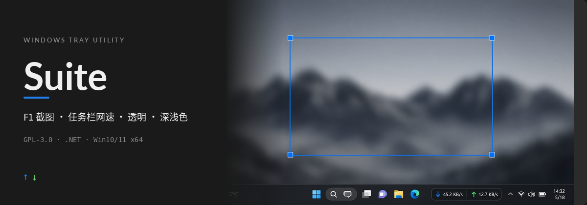

<p align="center">
  
</p>

<p align="center">
  <strong>一个纯原生单进程托盘工具：F1 截图标注 / OCR / 长截图、贴图、任务栏网速、任务栏透明与系统深浅色切换</strong>
</p>

<p align="center">
  <a href="LICENSE"></a>
  
  
</p>

**Suite v0.2.0** 已全面重写为 **纯原生 Rust（Win32 + Direct2D / DirectWrite + DXGI + WinRT OCR）** 单进程托盘宿主（仅保留 C++/WinRT XAML Diagnostics 注入模块 `TaskbarFx.Tap.dll`）。相比原 .NET / WPF 版本，分发体积缩小至约 **1.4 MB**，运行时常驻内存大幅降低，且完全兼容旧版 `settings.json` 与历史截图目录。

---

## 核心功能

| 能力 | 说明 |
| --- | --- |
| **F1 区域截图与标注** | DXGI / GDI 多屏抓取、窗口吸附与放大镜；内置矩形/椭圆、曲线/箭头、铅笔、马克笔、马赛克、原生中文 IME 文字输入、橡皮擦、撤销/重做及快捷键（`Ctrl+C/S/T/O/Z/Y`、`1–6` 切工具、`C` 选区取色） |
| **WinRT 离线识字 (OCR)** | 标注工具栏一键离线识别框选区域文字并自动复制到剪贴板 |
| **滚动长截图 (`F4`)** | 选区实时显示已拼接像素高度，停滚 1.5 秒自动完成拼接并复制/保存 |
| **屏幕取色 (`F2`)** | 放大镜像素取色，`Space`/`Shift` 切换 `HEX` 与 `rgb(...)` 格式复制 |
| **置顶彩虹贴图 (`F3` / `Ctrl+Shift+Q`)** | Direct2D 分层渲染，流动彩虹悬停描边、滚轮缩放、透明调节、鼠标穿透及贴图管理 |
| **任务栏嵌入网速** | Direct2D `UpdateLayeredWindow` **真嵌入主/副任务栏**（或独立悬浮窗），随文本行宽自动适配槽位，支持切换「自动选择」或指定物理网卡 |
| **任务栏透明外观** | Win10 `SWCA` 与 Win11 `TaskbarFx.Tap.dll`（清晰 / 亚克力 / 不透明 / 原生），带 `CrashGuard` 自动保护 |
| **一键切换深浅色** | 同步切换 Windows 应用与系统深浅色，设置、历史、贴图管理窗口全套适配 Win11 沉浸式深色标题栏与自绘导航栏 |

---

## 安装与升级

1. 打开 [Releases](https://github.com/tsumon/suite/releases)，下载 `Suite-Setup-0.2.0.exe`（安装版）或 `Suite-portable-0.2.0.zip`（便携版）。
2. 若本机已安装 0.1.x 版本，直接运行 `Suite-Setup-0.2.0.exe` 即可原位升级，安装器会自动关闭旧版并清理遗留 `.NET` 运行库，同时保留 `%LOCALAPPDATA%\Suite\settings.json` 与历史截图。
3. **便携版**需保持 `Suite.exe` 与 `TaskbarFx.Tap.dll` 处于同一目录。布局约定见 [`installer/PORTABLE.md`](installer/PORTABLE.md)。

---

## 杀软与 `TaskbarFx.Tap.dll`

Win11 任务栏透明路径需向 `explorer.exe` 注入 `TaskbarFx.Tap.dll`（改编自 TranslucentTB）。部分杀毒软件或 EDR 可能拦截该 DLL；即便被拦截，截图、识字、贴图、网速与深浅色切换等核心功能仍会照常工作，且 `CrashGuard` 会在连续异常退出后自动关闭任务栏透明以保护主进程稳定性。

---

## 从源码构建

需 Windows 10/11 (x64)、Rust 工具链（MSVC x64）、VS 2022 C++ Build Tools，以及可选的 [Inno Setup 6](https://jrsoftware.org/isinfo.php)。详见 [`rust/README.md`](rust/README.md)。

```powershell
# 运行静态检查与单元测试
cmd /c "cd /d rust && cargo clippy --workspace --all-targets --offline && cargo test --workspace --offline"

# 一键构建 C++ TAP + Rust Release + 便携包 + 安装包（输出到 dist-rs\）
powershell -ExecutionPolicy Bypass -File scripts\build-rust.ps1
```

---

## 许可

**GPL-3.0**。见仓库根目录 [`LICENSE`](LICENSE) 与 [`NOTICE`](NOTICE)（包含 TranslucentTB 等开源归属声明）。
